

  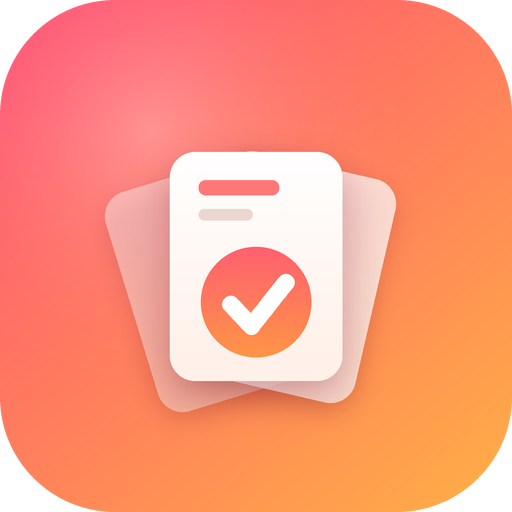

# DecXNote 📝

**A modern, card-based to-do app for Android, iOS, the web and Windows.** Your tasks live in a swipeable deck of glass cards: swipe right to finish one, swipe left to delete it, or jump straight to any note you want. Sign in with email, and your notes sync in real time through Firebase.

  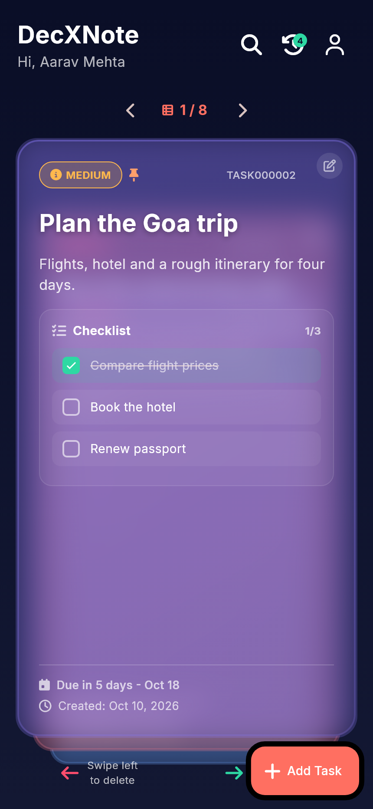
  &nbsp;
  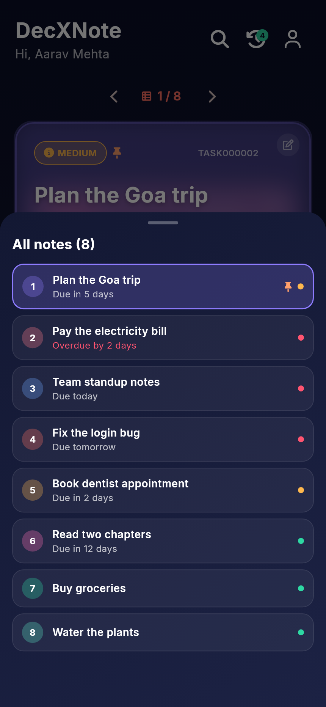
  &nbsp;
  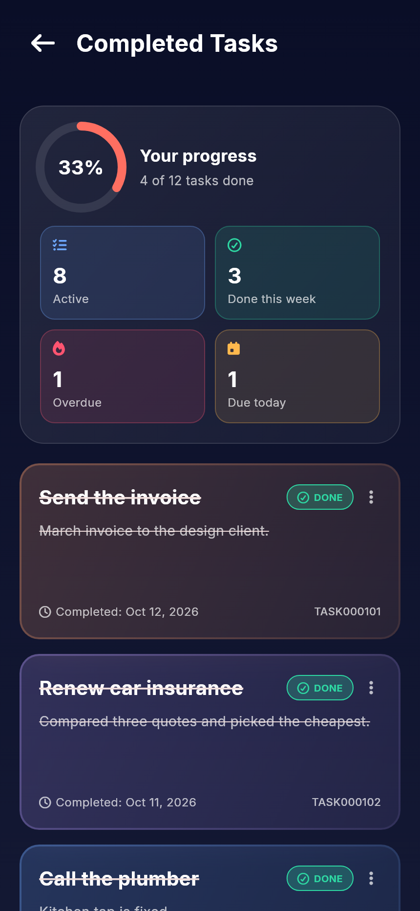

## 🎨 Logo and app icon

  

A fan of swipeable task cards with the top one ticked off, in warm coral to orange. The same coral-on-midnight-navy palette runs through the whole app. The logo is used on the sign-in screen, the splash screen and the navigation rail, and as the launcher icon on Android, iOS, the web and Windows.

## ✨ Features

**Your deck of notes**
- 🃏 **Swipeable card deck** - swipe right to complete, swipe left to delete (with a confirmation). Cards loop, so no note is ever out of reach.
- 🔢 **Jump to any note** - a counter such as `3 / 12` shows where you are; tap it to open a list of all notes and jump straight to one. Previous / next buttons wrap around, and on the web and Windows the arrow keys and the mouse wheel flip through the deck too.
- 📋 **Note list next to the deck** on wide screens - click any note to bring it to the top.
- 🔎 **Search** across titles, descriptions, task IDs and checklist items. The deck shows the matches right away.
- 🎚️ **Filter and sort** - by priority (high, medium, low) and due date (overdue, today, upcoming, no date); sort by smart order, newest, due date, priority or title.
- ↩️ **Undo** - bring back a deleted or completed task with one tap.

**Organising work**
- ✅ **Tasks with checklists** - tick items off on the card; when every item is done the task completes itself.
- 📅 **Due dates** with overdue / due today / due tomorrow indicators.
- 📌 **Pin** important tasks to the top of the deck.
- 🚦 **Priorities** with colour coding.
- 📈 **Progress summary** - completion ring, active tasks, done this week, overdue and due today, plus an "Up next" list on wide screens.
- 🗂️ **Completed tasks** - review, restore, edit or permanently delete finished tasks.

**Account and look**
- 🔐 **Email sign-in** with Firebase Authentication, a profile page and profile editing.
- 🔄 **Real-time sync** across devices with Cloud Firestore.
- 🪟 **Glassmorphic dark theme** with coral accents, smooth animations and clear empty states.
- 📱💻 **Responsive** - phones keep the card-deck layout; wide windows get a desktop layout.

## 🖥️ Supported platforms

| Platform | Support |
| --- | --- |
| Android | ✅ Phone layout |
| iOS | ✅ Phone layout |
| Web | ✅ Phone layout in a narrow window, desktop layout in a wide one |
| Windows | ✅ Desktop layout (the window is resizable and switches to the phone layout when narrow) |

## 📸 Screenshots

### Mobile

| Sign in | Home deck | Jump to any note |
| :---: | :---: | :---: |
| 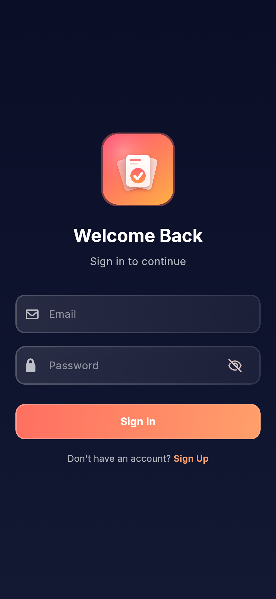 |  |  |

| Search and filters | Add a task | Completed and progress |
| :---: | :---: | :---: |
| 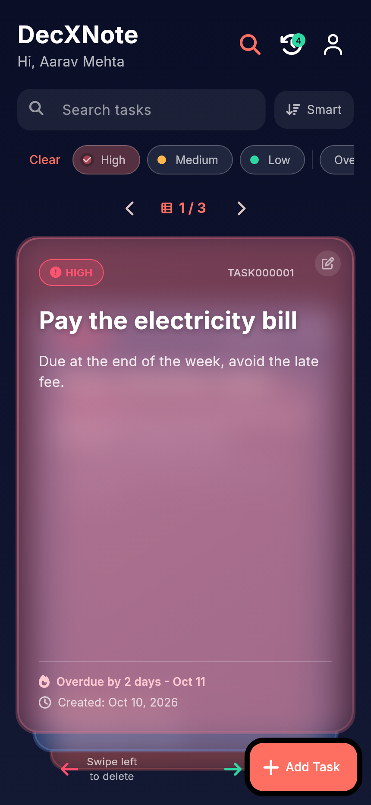 | 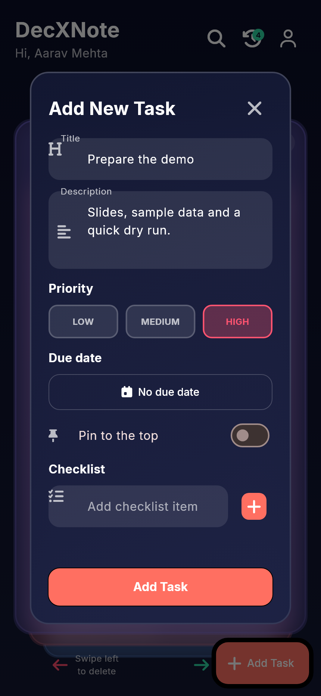 |  |

| Profile |
| :---: |
| 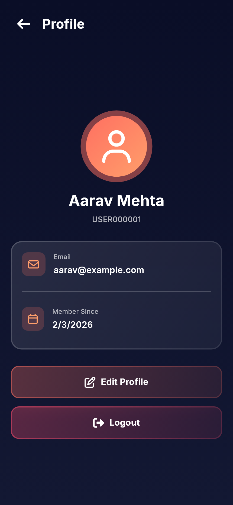 |

### On the web and Windows

On wide windows (840 px and up) DecXNote switches to a desktop layout with a navigation rail, a list of all your notes next to the card deck, a grid view with one-click actions, and a progress side panel. **Phones and narrow windows keep the mobile layout shown above.**

**Deck view** - every note is listed on the left; click one to bring it to the top of the deck.

  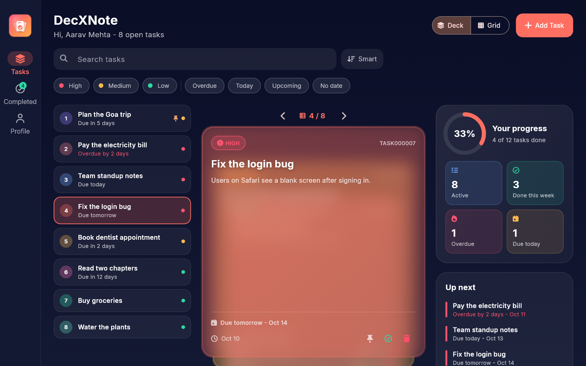

**Grid view** - all your tasks as cards, with pin, complete and delete buttons.

  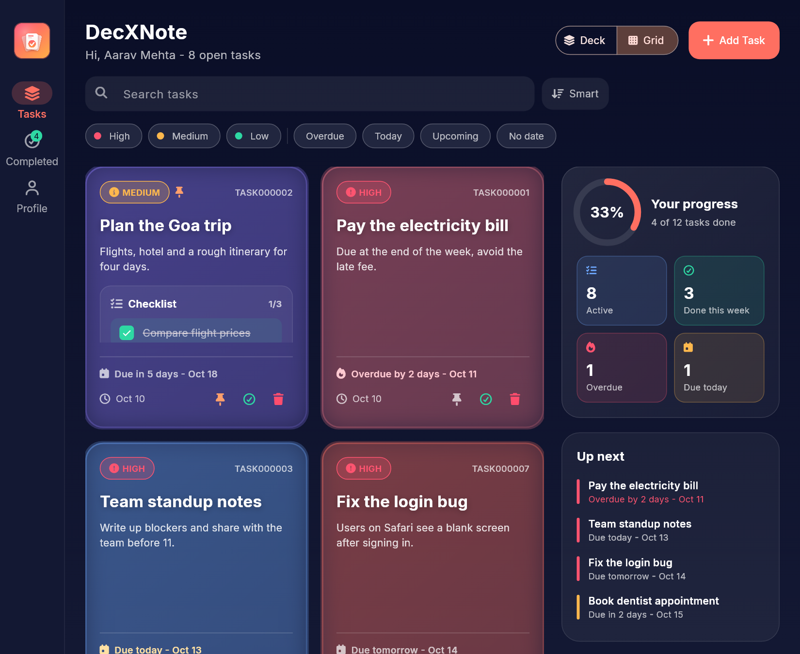

| Completed tasks and progress | Profile |
| :---: | :---: |
| 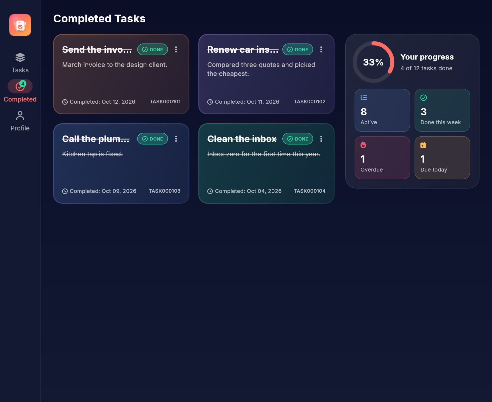 | 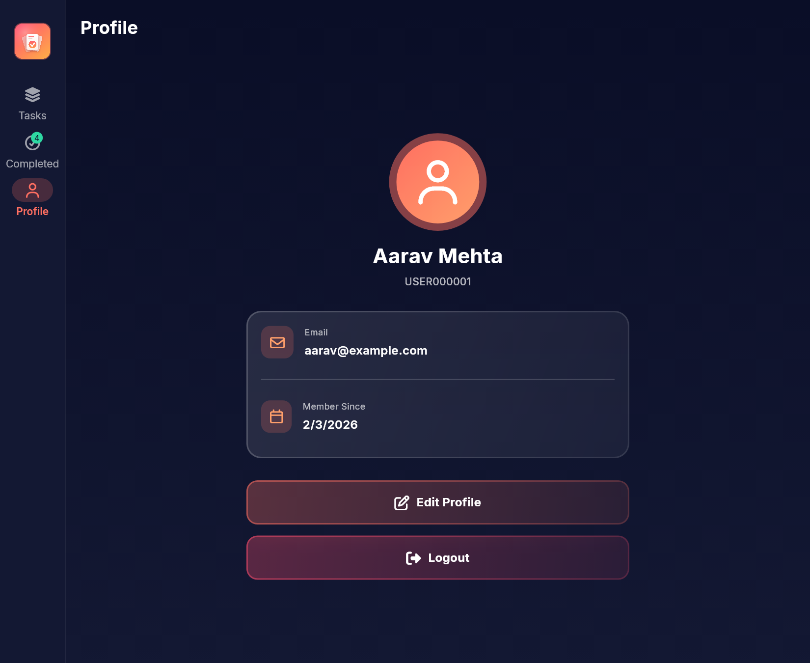 |
